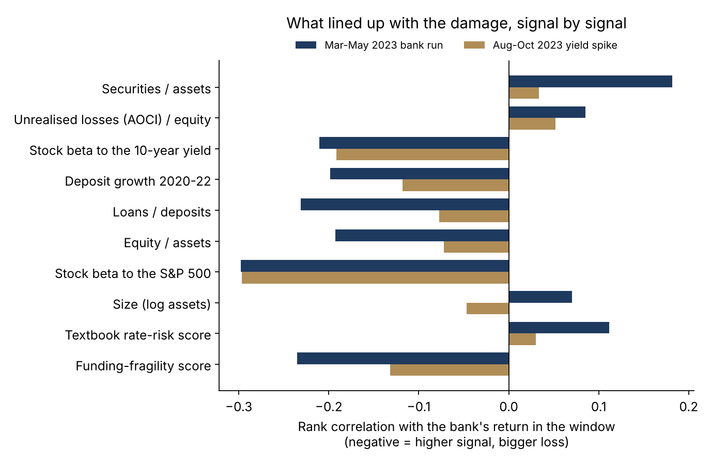
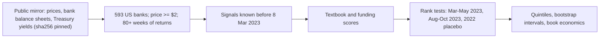

# Did the rate-risk screen catch the 2023 bank run? US bank stocks, 2021–2023

After the 10-year Treasury yield passed 4% in 2022, the textbook warning for banks was unrealised losses on securities. This project asks whether a rate-risk screen built from information public before 8 March 2023 would have ranked which bank stocks fell hardest in the March–May 2023 run, and whether the answer held in the August–October 2023 run of the 10-year yield toward 5%.

## Results

- **The textbook screen failed.** A score fixed in advance (more securities, deeper unrealised losses, faster deposit growth, stock beta to the 10-year yield) pointed the wrong way: rank correlation +0.11 with returns. Its safer half fell 26.3% and its riskier half 22.8%; holding only the safer half would have cost $17.7m more per $1bn than holding all 446 banks.
- **Funding and beta did the work.** Banks that had lent out more of their deposits (rank correlation −0.23), grown deposits fastest in 2020–22 (−0.20), held less equity (−0.19) or carried a higher S&P 500 beta (−0.30) fell further. Holding the safer half by market beta lost 17.7% against 26.0% for the riskier half: $41.4m saved per $1bn.
- **Out of sample.** In the August–October 2023 yield spike, market beta held (−0.30; safer half saved $24.3m per $1bn) and the funding score, defined after the first run, held more weakly (−0.13; $6.7m). The textbook score stayed at zero (+0.03).
- **A large securities book was not the danger among survivors.** Securities as a share of assets lined up with smaller losses (+0.18). The banks whose books were the extreme cases, Silicon Valley Bank, Signature and First Republic, failed and are missing from the data, so this test cannot say whether the screen would have flagged them.



## The commercial case

| Element | What it is |
|---|---|
| Who pays | Bank-equity and bank-credit investors, corporate treasurers placing deposits, bank ALM and IRRBB teams, regulators' outside advisers |
| The problem | The equal-weight bank book fell 21.9% in eight weeks while the S&P 500 rose 1.6% |
| The product | A bank funding-fragility monitor: funding, capital and beta signals each quarter, with the securities book shown as context rather than the headline |
| Proof | 446 banks, signals fixed before the window, one out-of-sample episode, bootstrap intervals |
| Build vs buy | 3–4 weeks on public filings and prices; most buyers rely on ratings, call-report vendors or the securities-loss headline |
| Pricing logic | $25–75k a year per client (illustrative): the beta screen saved $24–41m per $1bn of bank equity in the two episodes |
| Adoption risk | Two episodes and survivor-only data; sell it as risk control and judge it on drawdown in the next stress |

## Method

1. Universe: every bank in the mirror's company profiles (Banks-Regional and Banks-Diversified), price at least $2 and at least 80 weeks of returns before the window.
2. Price signals: weekly regression of each bank's return on the S&P 500 ETF return and the change in the 10-year yield, January 2021 to 3 March 2023.
3. Balance sheet, end of 2022 (in Q4 earnings releases in January 2023): securities / assets, accumulated other comprehensive income / equity, deposit growth since end-2020, loans / deposits, equity / assets, size.
4. Textbook score, fixed in `configs/default.yaml` before any crisis return was viewed: equal-weight z-scores of securities share, AOCI, deposit growth and the yield beta.
5. Funding score, defined after the first run: deposit growth, loans / deposits, equity / assets. Its crisis numbers are in sample; August–October 2023 is its test.
6. Returns: close on 8 March 2023 (before Silicon Valley Bank's news) to 4 May 2023; then 15 August to 27 October 2023. Placebo: 8 March to 4 May 2022. Strict-lag check: end-2021 balance sheets.
7. Tests: Spearman rank correlation, quintile returns, 2,000-draw bootstrap intervals for riskiest-minus-safest fifth, and an equal-weight book that holds only the safer half.



## Run it

```
pip install -r requirements.txt
make ingest   # downloads four public files (~0.6 GB), checks sha256, writes small extracts
make run      # reports/metrics.json and reports/figures/*.png
make test
```

## Limits

- Survivorship: banks that failed or were absorbed are missing, including Silicon Valley Bank, Signature, First Republic and PacWest. The test covers the survivors' losses, not the failures.
- Two stress episodes; the funding score was chosen after seeing the first.
- Prices are split-adjusted, not dividend-adjusted; over eight weeks the effect is under one point.
- End-2022 balance sheets come from annual filings; most banks published the same figures in January earnings releases, but a few small banks filed later.
- No uninsured-deposit or held-to-maturity fair-value data in the mirror, the two measures most linked to the failures.
- Independent research on public data; not deployed; not investment advice.

## Data and licences

- Prices, company profiles, financial statements and Treasury yields: [huggingface.co/datasets/defeatbeta/yahoo-finance-data](https://huggingface.co/datasets/defeatbeta/yahoo-finance-data) (ODC-BY), pinned by sha256 in `configs/default.yaml`.

## References

- Jiang, E. X., Matvos, G., Piskorski, T. and Seru, A. (2023), "Monetary Tightening and U.S. Bank Fragility in 2023: Mark-to-Market Losses and Uninsured Depositor Runs?" NBER Working Paper 31048.
- Drechsler, I., Savov, A. and Schnabl, P. (2021), "Banking on Deposits: Maturity Transformation without Interest Rate Risk," *Journal of Finance* 76(3), 1091–1143.
- Board of Governors of the Federal Reserve System (2023), press release on the Bank Term Funding Program, 12 March 2023.
- Spearman, C. (1904), "The Proof and Measurement of Association between Two Things," *American Journal of Psychology* 15(1), 72–101.
- Efron, B. (1979), "Bootstrap Methods: Another Look at the Jackknife," *Annals of Statistics* 7(1), 1–26.

Code MIT-licensed. Code, analysis, charts and text were produced with AI assistance (Claude, by Anthropic) and reviewed by Gaurav Gupta.
